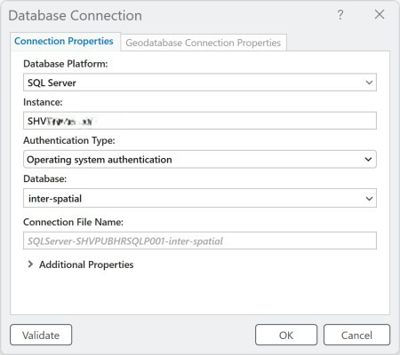

# Storage and Access {.unnumbered}

Data storage refers to the methods and technologies used to store, manage, and preserve digital data for the Epidemiology Unit. It involves the use of various hardware and software components that work together to ensure that data is organized, accessible, and secure.

Epidemiology Unit staff has access to multiple forms of data storage that serve different functions including personal, temporary file storage, local network and cloud-based team and collaborative project file storage. Outlined below is a general description of each category of data storage, how data are accessed and managed, along with associated usage best practices.

## Hard drive on personal laptop or desktop

Each employee receives a personal laptop or desktop machine. The local hard drive on these devices is available for personal data storage. Given their limited storage capacity, these drives should be used only for small, short-term projects prior to transfer to OneDrive or Shared file folders and other miscellaneous or temporary file storage related to work activities. The contents of these local hard drives are not, by default, backed up on the department network or cloud. Data on these drives are also not readily accessible to management.

## CCDPH network storage

CCH has an internal network that was originally designed for sharing data across the organization. Epidemiology Unit staff can request access to the *ArcGIS* network folder ("//fileshare/shared/ArcGIS"). Content of this folder is securely stored in a HIPAA-compliant fashion and is useful for archiving raw datasets that have protected health information (e.g., vital statistics, hospital discharge, survey results), related documentation and conventional spatial datasets (e.g., CCDPH jurisdiction, zip code, census tract and municipal boundary files) as well as ArcGIS maps and templates. File storage capacity on this network is relatively large.

Access to the network drive is limited to CCH staff who have Windows authenticated access to the Cook County Health and Hospital System (CCHHS) network domain (i.e., staff who have a CCHHS user name and password). The network drive can only be accessed via a computer that is either directly connected to the network via a LAN or ethernet cable or through a virtual or VPN-based remote desktop service. Files and folders stored exclusively on the network drive cannot be shared directly with external partners.

## Personal OneDrive

Microsoft OneDrive is a cloud-based data management utility. Each staff person has their own OneDrive which is linked to their CCHHS account. OneDrive files and folders can be accessed via a web-based OneDrive application, the Windows 365 environment and or through synchronized folders and files on Windows File Explorer.

The personal OneDrive is mainly used for managing individual project folders and files. It is where most of projects are developed and drafted. This is where project directory measures and standards are applied. Establishing a good project management and structure is important for consistency and reproducibility. (Please review the Project Structuring Guide).

## Teams SharePoint files

SharePoint is a cloud-based Microsoft application that can syncronizes with OneDrive. used by CCH as a secure sharing platform, directory management tool, and version control software (along with One Drive). After completing the drafts of ongoing projects, Share Point serves as the collaborative platform where these projects can be shared with other team members, internal stakeholders, or external stakeholders (*in certain situations*). The sharing process is governed by the \textcolor{purple}{Sharing Policies} and \textcolor{purple}{Data Use Agreements}.

## CCDPH SQL Server {#sec-ccdph_sql_server_storage}

SQL Server refers to a relational database management system (RDBMS) developed by Microsoft. It is designed to store and manage large amounts of data and is used by organizations of all sizes for a wide range of applications. SQL Server supports the Structured Query Language (SQL), which is a standard language used to manage relational databases. SQL Server provides a wide range of features and services, including: (1) Data storage and management: SQL Server provides efficient storage and retrieval of data, allowing for quick access to large amounts of data: (2) Security: SQL Server provides robust security features, including authentication, authorization, and encryption, to protect data from unauthorized access; (3) Integration with other Microsoft technologies: SQL Server integrates seamlessly with other Microsoft technologies such as Excel, OneDrive, and SharePoint. [@trick2021a]

The CCDPH SQL Server was established by the Health Information Services (HIS) Department server in summer 2022 at the request of the Communicable Disease and Epidemiology Units as part of an effort to centralize and coordinate efficient and secure data storage and sharing within and between the units. The CCDPH SQL Server includes patient-level vital statistics, hospital discharge, communicable disease cases and other data used by CCDPH epidemiologists in their surveillance activities. Information stored on the server change regularly as databases and tables are created and modified.

The CCDPH SQL Server is [HIPAA-compliant](https://www.hhs.gov/hipaa/index.html) and therefore can securely store PHI. And while data stored on the server are archived regularly, it is not a cloud service and does not readily support versioning.

Only select CD and Epi unit employees and interns have access to information stored on the CCDPH SQL Server. Permissions to read and/or edit data objects on the server are set by data owners and are limited to staff who have Windows authenticated access to the Cook County Health and Hospital System (CCHHS) network domain (i.e., staff who have a CCHHS user name and password). Third parties outside of CCHHS do not have access to the service. Access to the service, databases, tables and particular table columns are granted to employees on a must-need basis. The server name are shared with staff upon access approval. Data are managed by designated data owners and editors.

The first step to gaining access to the server is to *send an email request to a data owner.* CD staff should request access from [Kelley Bemis](mailto:kbemis@cookcountyhealth.org) (Program Manager) and Epidemiology Unit staff should request access from [Scott Smith](mailto:christopher.smith@cookcountyhealth.org) (Project Coordinator). The email should specify the particular datasets needed (e.g., death certificate records). The data owner will respond with the server name and names of databases, tables, and/or columns to which the requester has been granted access.

Data stored in SQL Server tables are identified using schema. The particular schema that tables belong to are noted using a standard prefix. Schema, together with standard table naming conventions, indicate the type and stage of data. Schema also indicate whether data contain protected health information (PHI) and are therefore useful when granting permissions to data users.

-   dbo = default "database owner" used exclusively by db owners for temporary storage (may contain phi)
-   raw = "raw", uncleaned data tables imported directly from source (may contain phi)
-   frm = "formatted", cleaned, value-added datasets (may contain phi)
-   pub = "publishable" data suitable for public dissemination (does not contain phi)
-   ref = "reference" data including census counts, look up tables, geographic boundaries (does not contain phi)

Users may access server data via different platforms. Instructions for access via select protocols are provided below.

### Accessing and manipulating SQL Server tables in R
#### Encrypt SQL Server service name using keyring
Prior to accessing SQL Server data in R, it is first necessary to encrypt the service name of the CCDPH SQL Server. We do this in order to remove explicit references to the server name in code that is saved in GitHub repositories. The standard practice for encrypting passwords in R is to use the [keyring](https://cran.r-project.org/web/packages/keyring/index.html) package. For example, the below code *key_set("ccdph_sql_server")* will prompt the user to type in and "set" the server name in keyring. Once set, the user may access the encrypted key in R code using the command, *key_get("ccdph_sql_server")*. Databases and tables to which you have been granted access will appear in the RStudio Connections tab. Refer to instructions in subsequent sections of this document to learn more about how to import, export, and edit objects on SQL Server.

```{r}
#| collapse: false
#| label: encrypt server name using keyring
#| code-fold: false

# activate keyring package
library(keyring)

# set server name "password" as "ccdph_sql_server"
# when prompted type in/copy protected server name "password" into dialog box 
key_set("ccdph_sql_server")

# retrieve/get server name in code
key_get("ccdph_sql_server")

```

#### Read/import SQL Server data tables into R
There are numerous ways to read or import SQL Server data into R. This code demonstrates how to connect to a SQL Server from R, execute SQL statements, transfer data between SQL Server and R, and write R data frames back to the database. It establishes secure connections using stored credentials, runs SQL scripts and ad-hoc queries, reads both tabular and spatial data into R, and saves processed R data back to a specified schema and table in SQL Server.

```{r}
#| label: access and manipulate database content
#| code-fold: false

# activate packages
library(keyring)
library(DBI)
library(dbplyr)
library(dplyr)
library(odbc)
library(sf)

# connect to server
con_ccdph_sql_server <- dbConnect(odbc::odbc(),
                        Driver   = "SQL Server",
                        Server   = key_get("ccdph_sql_server"))

# connect to database
con_epi_database <- dbConnect(odbc::odbc(),
                        Driver   = "SQL Server",
                        Server   = key_get("ccdph_sql_server"),
                        Database = "database-name")

# execute SQL code/script on server
# execute from SQL file
dbExecute(conn = con_epi_database, 
          statement =  read_file("file/path/name.sql"))

# executive SQL from character string
dbExecute(conn = con_epi_database, 
          statement =  "SELECT TOP 10 * INTO [schema_name].[table_name] FROM [schema_name].[table_name] ")

# import/read table from server
# execute using dbGetQuery
imported_data <- dbGetQuery(conn = con_epi_database,
                            statement =  "SELECT TOP 10 * FROM [schema_name].[table_name]")

# read table from server using dbplyr
imported_data <- con_epi_database %>%
  tbl(in_schema("schema_name","table_name")) %>%
  collect()

# write R dataframe to SQL Server database using specified schema
table_id <- DBI::Id(
  schema = "schema_name",
  table = "table_name"
)

dbWriteTable(conn =  con_epi_database,
             name = table_id, 
             value = data_frame_name, 
             overwrite = TRUE,
             append = FALSE)

```

### Accessing (reading and writing) SQL Server spatial data in R

This section establishes a reusable workflow for reading and writing spatial data between R
and the CCDPH **inter-spatial SQL Server database**. It loads the required R libraries,
configures secure database authentication, and imports two custom functions from the
[CCDPH GitHub repository](https://raw.githubusercontent.com/Cook-County-Department-of-Public-Health/ccdph-functions/master/spatial-database-functions.R)
that abstract the complexity of spatial database interactions into simple, repeatable function calls.

#### Library Dependencies

The following R packages are required:

| Package | Role |
|---|---|
| `sf` | Reading, writing, and transforming spatial (simple feature) data |
| `DBI` / `odbc` | Database connectivity to SQL Server |
| `dplyr` / `dbplyr` / `tidyverse` | Data manipulation |
| `keyring` | Secure, encrypted storage of the SQL Server credentials |
| `tigris` | Access to U.S. Census Bureau spatial data (supplemental) |

#### Secure Authentication

The SQL Server instance name is stored as an encrypted credential using the `keyring` package.
This avoids hardcoding sensitive server information in scripts. Before using these functions
for the first time, run the following once to register your credentials:

```r
keyring::key_set("ccdph_sql_server")
```

This prompts you to enter the server name, which is then stored securely in the system
credential store and retrieved automatically in subsequent sessions.

#### Importing the Functions

The two core functions are sourced directly from the CCDPH GitHub repository at runtime,
ensuring access to the latest version without managing local copies:

```r
source("https://raw.githubusercontent.com/Cook-County-Department-of-Public-Health/ccdph-functions/master/spatial-database-functions.R")
```

#### Function Reference

##### `fx_read_spatial_layer_fr_database()`

Reads a spatial table from the inter-spatial database and returns it as an `sf` object in R.

| Parameter | Description | Default |
|---|---|---|
| `schema_name` | Database schema containing the table | `"ref"` |
| `db_table_name` | Name of the spatial table to read | *(required)* |
| `crs_id` | Coordinate Reference System (EPSG code) | `3435` |

::: {.callout-note}
All layers in inter-spatial are stored in **CRS 3435** (Illinois State Plane). Specifying
`crs_id = 4326` will automatically reproject the data to WGS 84, which is required for
interactive mapping with `leaflet`.
:::

**Example:**

```r
counties_illinois_sf <- fx_read_spatial_layer_fr_database(
  db_table_name = "counties_illinois",
  crs_id = 4326
)
```

##### `fx_write_spatial_layer_to_database()`

Writes an `sf` object from R to the inter-spatial database. The function handles geometry
conversion, table creation, and cleanup automatically. By default, it overwrites any existing
table with the same name.

| Parameter | Description | Default |
|---|---|---|
| `sf_layer_name` | The `sf` object in R to write | *(required)* |
| `schema_name` | Target database schema | `"ref"` |
| `db_table_name` | Name for the new database table | *(required)* |
| `crs_id` | CRS to store the data in (EPSG code) | `3435` |

**Example:**

```r
counties_il_db <- fx_write_spatial_layer_to_database(
  sf_layer_name = counties_illinois_sf,
  schema_name   = "ref",
  db_table_name = "counties_illinois_DELETE",
  crs_id        = 3435
)
```

#### Using These Functions in Other Scripts

To leverage these functions in any other R or Quarto script, follow these steps.

**Step 1 — Install required packages** *(one time only)*:

```r
install.packages(c("sf", "DBI", "odbc", "dplyr", "dbplyr",
                   "tidyverse", "keyring", "tigris"))
```

**Step 2 — Store your credentials** *(one time only)*:

```r
keyring::key_set("ccdph_sql_server")
```

**Step 3 — Load libraries and source the functions at the top of your script**:

```r
library(sf)
library(DBI)
library(odbc)
library(dplyr)
library(dbplyr)
library(tidyverse)
library(keyring)
library(tigris)

source("https://raw.githubusercontent.com/Cook-County-Department-of-Public-Health/ccdph-functions/master/spatial-database-functions.R")
```

**Step 4 — Call the functions as needed**:

```r
# Read a layer from the database
my_layer <- fx_read_spatial_layer_fr_database(
  db_table_name = "your_table_name",
  crs_id = 3435
)

# Write a layer to the database
fx_write_spatial_layer_to_database(
  sf_layer_name = my_layer,
  schema_name   = "ref",
  db_table_name = "your_new_table_name",
  crs_id        = 3435
)
```

::: {.callout-warning}
You must be connected to the CCDPH network or VPN to access the inter-spatial SQL Server.
:::

#### Full Code

```{r}
#| label: accessing-spatial-data-in-r
#| code-fold: true
#| code-summary: "Show code"
#| eval: false

# Activate required libraries
library(sf)
library(DBI)
library(odbc)
library(dplyr)
library(dbplyr)
library(tidyverse)
library(keyring)
library(tigris)

# The name of the CCDPH SQL Server service is encrypted.
# Set the name using keyring's key_set function (one time only):
# key_set("ccdph_sql_server")

# Import spatial database functions from CCDPH GitHub.
# This imports two functions for reading and writing spatial data to/from SQL Server.
source("https://raw.githubusercontent.com/Cook-County-Department-of-Public-Health/ccdph-functions/master/spatial-database-functions.R")

# Read spatial data example
counties_illinois_sf <- fx_read_spatial_layer_fr_database(
  db_table_name = "counties_illinois",
  crs_id = 4326
)

# Write spatial data example
counties_il_db <- fx_write_spatial_layer_to_database(
  sf_layer_name = counties_illinois_sf,
  schema_name   = "ref",
  db_table_name = "counties_illinois_DELETE",
  crs_id        = 3435
)
```

### Accessing spatial data in ArcGIS

Spatial data tables on the inter-spatial SQL Server can be imported directly into ArcGIS Pro for mapping. Follow the steps below.

#### Step 1: Connect to the Cook County ArcGIS Portal

Log into the Cook County ArcGIS portal at <https://cookcountyil.maps.arcgis.com> using your standard Cook County credentials. In ArcGIS Pro, confirm that Cook County is set as the active portal. If it does not appear, click **Add Portal**, sign in with your Cook County email credentials, and set it as the active portal.

#### Step 2: Create a New Database Connection

From the **Insert** menu, select **Connections**, then choose **Database > New Database Connection**. In the dialog box, configure the following settings:

| Setting | Value |
|---|---|
| Database Platform | SQL Server |
| Instance | *(enter the SQL Server instance name)* |
| Authentication Type | Operating System Authentication |
| Database | inter-spatial |

Click **OK**. The connection will appear under **Databases** in the Catalog Pane.

{#fig-mortalitydataprocess}

#### Step 3: Add a Spatial Data Layer to the Map

In the Catalog Pane, expand the new SQL Server connection to browse available spatial data layers. Right-click a layer and select **Add to Current Map**.

#### Notes & Limitations

::: {.callout-note}
SQL Server feature layers are **read-only** and cannot be edited directly.
:::

- You can modify **symbology** and apply **definition queries** to control what is displayed.
- **Attribute joins** can be added to the spatial data.
- To make an attribute join permanent, **export the feature layer** and save it locally or to the cloud.


### Microsoft applications via ODBC

To access server data using Microsoft applications, it is necessary to first install the SQL Server ODBC driver. Follow the steps below.

-   Type "ODBC Data Sources" into the Windows search prompt to open the ODBC Data Source Administrator dialog.
-   Click "New" in the dialog and select "SQL Server" as the driver type.
-   Type in a name (e.g., "CCDPH SQL Server") and description ("Centralized storage and management of Inter-Epi datasets") for ODBC connection along with server name received from SQL Server data owner.

#### Excel

-   In the "Get & Transform Data" tab, click the "Get Data" option
-   Choose the "From Other Sources", then "From ODBC" click the CCDPH SQL Server connection you created.
-   From here, you should be able to see the databases and tables to which you have access. Double-click a table to import a copy of the data into Excel.

### Microsoft SQL Server Management Studio

Microsoft SQL Server Management Studio (SSMS) is a software application developed by Microsoft that is used for configuring, managing, and administering all components within Microsoft SQL Server. CCDPH uses the . If you don't have the latest SQL Management Studio general availability (GA) version installed on your CCDPH machine, request installation by submitting a ticket through [Cook County's online help system](https://help.cookcountyhealth.org/support/home).

Once installed, open SQL Management Studio on a laptop or tower computer that is directly connected (via LAN not WIFI) to the CCHHS network. It is possible to use a remote desktop connection to log into a computer that is lined into the CCHHS network. The tower machines at Bridgeview, for example, are connected directly to the network via LAN cables. Refer to the [Epi Handbook](#) for information concerning how to log in remotely to an office computer.
